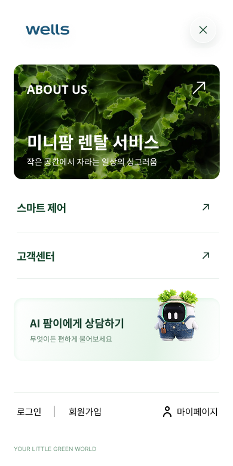
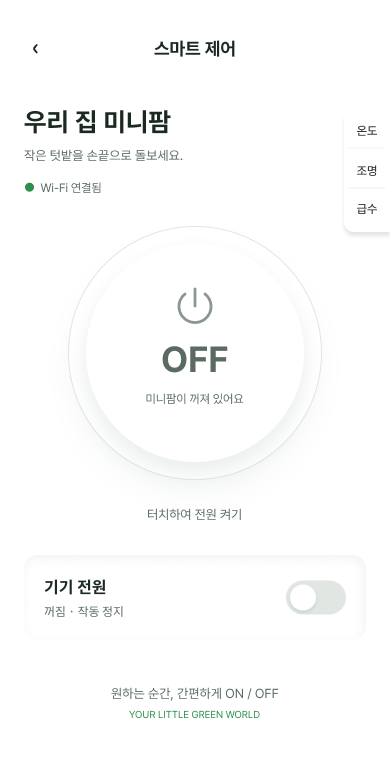
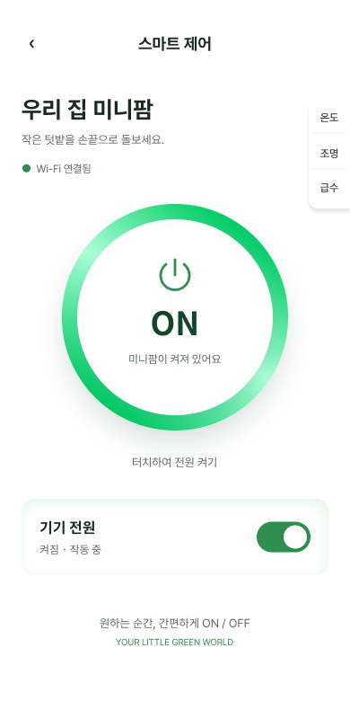
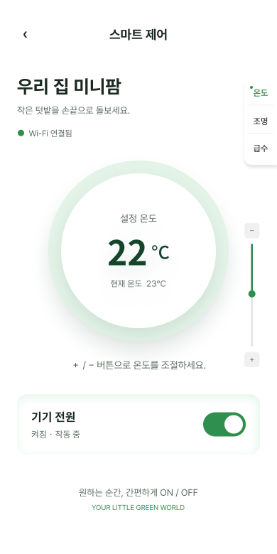
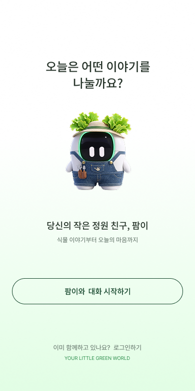

# 제공된 Figma 내보내기 원본 기준 미리보기

업로드된 `교원 웰스 팜 -마이크로 사이트 (5).zip`의 PNG 6장을 실제 화면에 반영했습니다. 앞서 올린 임시 앱 디자인과 문구를 원본으로 교체했습니다.

## 메인 화면


## 햄버거 메뉴



## 스마트 제어

| 전원 OFF | 전원 ON |
| --- | --- |
|  |  |



## AI 상담 소개



## 구현 범위와 검증

- 홈 메뉴 열기/닫기, 제품 구조 스크롤, 고객센터 이동, 전화 연결 링크
- 스마트 제어 화면 이동, 세션 내 전원 ON/OFF, 16~30°C 온도 조절
- AI 상담 소개 및 메시지 입력 시연 (실제 AI 서버 미연결을 화면에 명시)
- 390px에서 원본 PNG 6장과 브라우저 캡처의 RGB 픽셀 완전 일치 확인
- 320px에서 가로 넘침 없음, 데스크톱에서 원본 모바일 폭 390px 유지
- Chromium에서 메뉴, 전원 전환, 온도 ±, 상담 시연, 고객센터 이동 검증; JavaScript 오류 없음
- 프로덕션 빌드 및 빌드 결과를 제공하는 preview 서버에서도 동일한 기능 확인

**구현 방식:** 업로드된 자료는 편집 가능한 Figma 레이어나 개별 이미지 자산이 아니라 완성 화면 PNG입니다. 따라서 원본 화면 이미지를 사용하고 그 위에 접근 가능한 버튼과 링크를 배치했습니다. 원본 문구·제품 사진·간격을 그대로 보존하지만, 이미지 속 텍스트는 선택/검색할 수 없고 각 구성 요소가 개별 HTML로 재구성된 결과는 아닙니다. 온도를 바꾸면 설정값만 HTML로 표시합니다.

기기 전원·온도는 로컬 시연 상태이며 실제 기기에 연결되지 않습니다. 이미지에 그려진 Wi-Fi 연결 표시는 원본 디자인의 일부입니다. Slim 별도 화면, 로그인/회원가입, 예약·급수·조명 제어, 공지와 소셜 링크의 실제 서비스는 제공되지 않아 연결하지 않았거나 안내만 표시합니다. 로그인 링크는 AI 서비스 안내 화면으로 이동합니다.

## 실행

표준 설치가 가능한 깨끗한 개발 환경에서는 `npm ci`, `npm run dev`를 실행합니다. 저장소에 기존 `node_modules`가 추적되어 있으므로 온보딩 환경에서는 원본을 보존하기 위해 체크아웃 밖의 의존성과 Vite 설정을 사용합니다.

```sh
cd /workspace/---
/workspace/.cloud-setup/wellsfarm/node_modules/.bin/vite --config /workspace/.cloud-setup/wellsfarm/vite.config.mjs --host 127.0.0.1 --port 5173 --strictPort
```

클라우드 환경의 설치 및 시작 절차는 환경 설정 초안에 저장됩니다. GitHub에 소스를 올리는 작업과 웹사이트 배포는 별개입니다.
