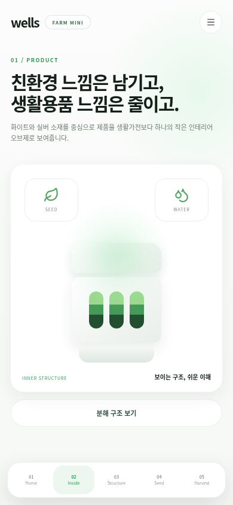

# 클라우드 환경 설정 및 화면 미리보기

기존 앱을 실제 실행하여 390px 모바일 화면으로 캡처했습니다. 이번 작업에서는 앱 디자인과 기능 코드를 변경하지 않았습니다.

## 홈 화면

## 제품 소개 화면

홈에서 ‘제품 구조 보기’를 누르면 이동하는 `/inside` 화면입니다.

## 검증한 작업

- Node.js 24.19.0, npm 11.9.0 환경에서 잠금 파일 기반 의존성 설치
- 프로덕션 빌드 성공 (번들 크기 경고 있음)
- 개발 서버 실행 및 페이지·모듈 HTTP 응답 확인
- Chromium에서 모바일 홈 렌더링 및 `/inside` 이동 확인
- 위 화면 이동 중 JavaScript 오류 없음
- 별도 테스트 스크립트는 저장소에 없음

저장소에 추적된 `node_modules`를 보존하기 위해 클라우드 전용 의존성·설정·빌드 결과는 체크아웃 밖에 준비했습니다. 재사용할 설치 및 시작 절차는 클라우드 환경 설정 초안에 저장했습니다. 환경 게시와 새 작업에서의 복원은 아직 확인하지 않았습니다.
