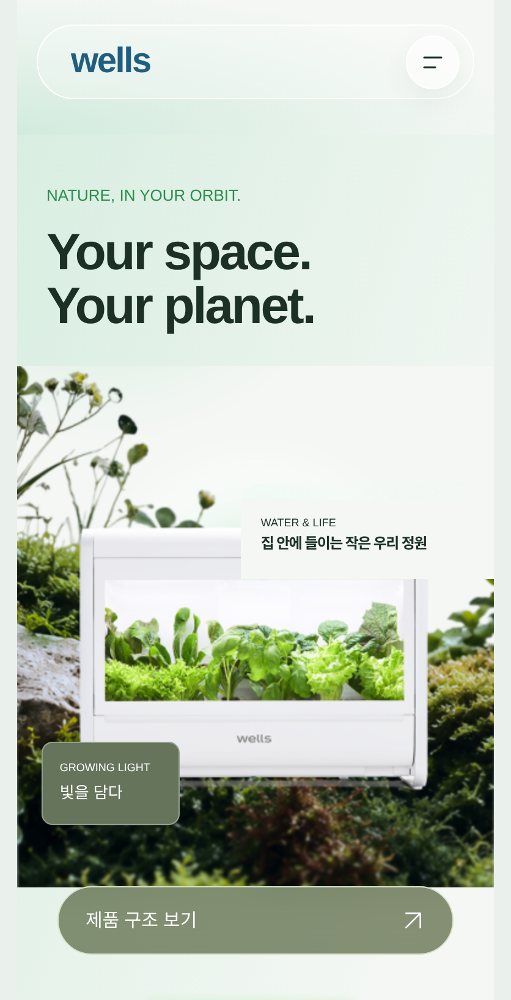
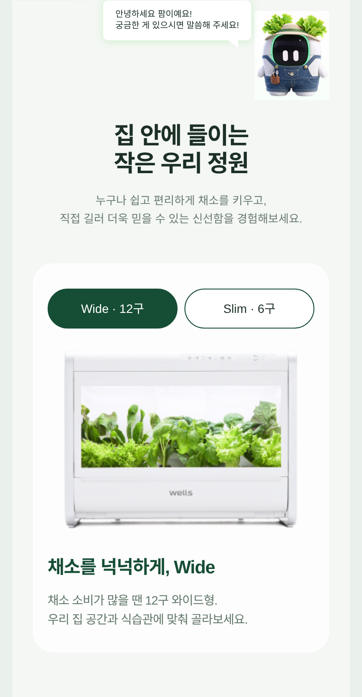
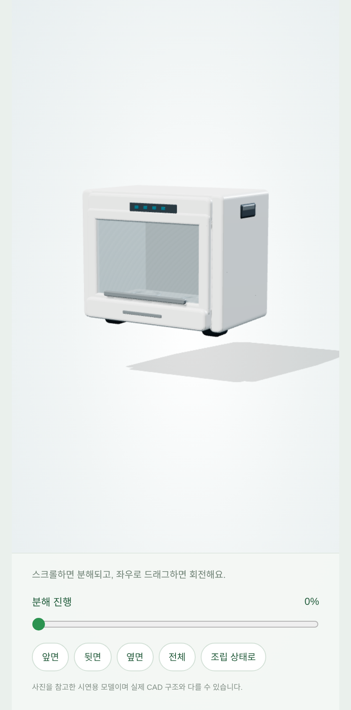
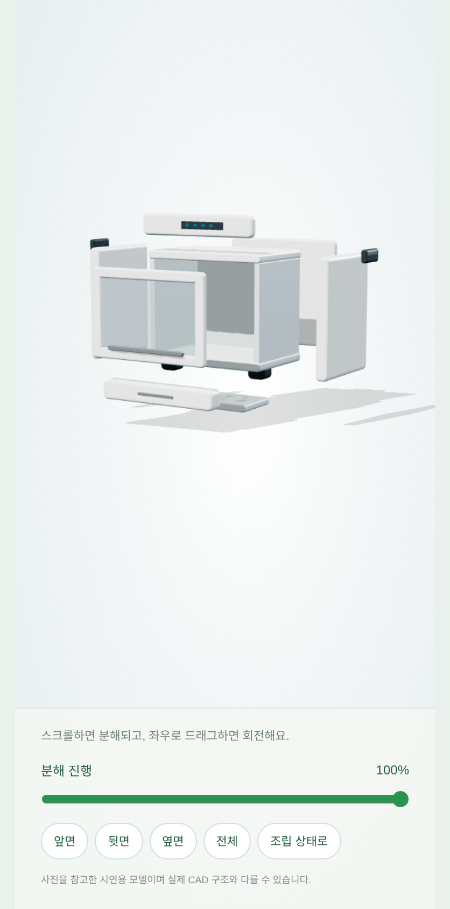
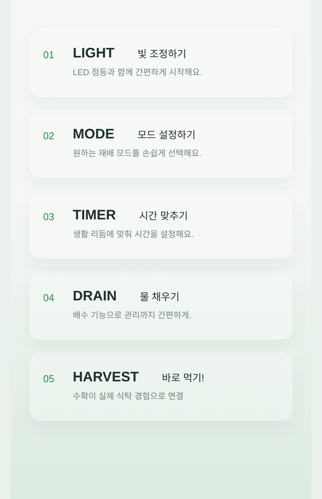
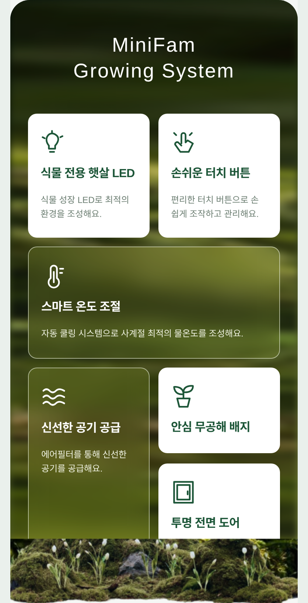
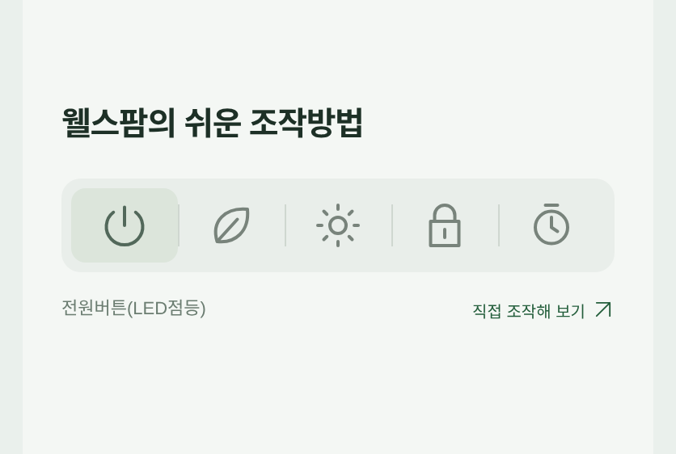
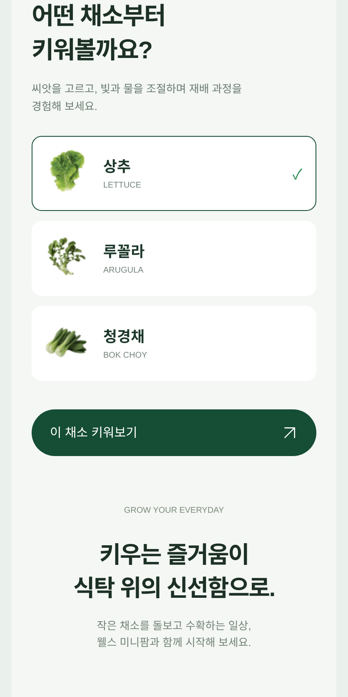
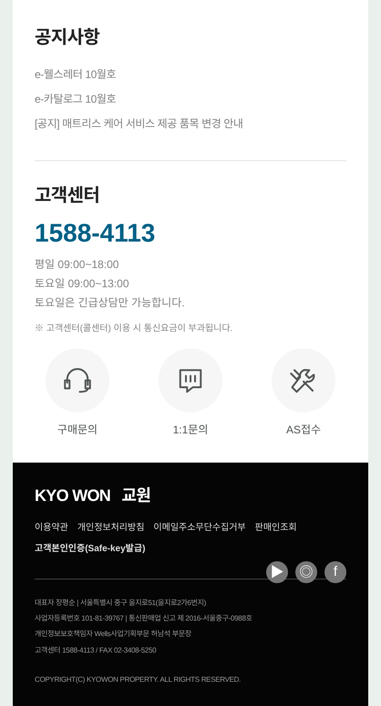

# 모바일 구간별 화면

요청한 예시처럼 화면 구간을 묶어 잘랐습니다. 공지사항·고객센터·푸터는 한 장으로 이어집니다. 모바일 418px 화면 안에 콘텐츠 폭 390px로 표시하고, 2배 해상도로 캡처했습니다.

## 01. 메인

## 02. 제품 소개

## 03. 제품 구조

3D 분해 상태:

## 04. 사용 단계

## 05. 재배 시스템

## 06. 조작방법

## 07. 채소 선택

## 08. 공지사항 · 고객센터 · 푸터

