# 모바일 섹션별 미리보기

최종본을 가로 390px 기준 13장으로 나눴습니다. 각 이미지의 높이는 최대 720px이며, 실제 앱에서도 이 순서대로 빈틈없이 이어집니다.

## 01. 헤더

390 × 110px

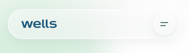

## 02. 메인 비주얼

390 × 720px

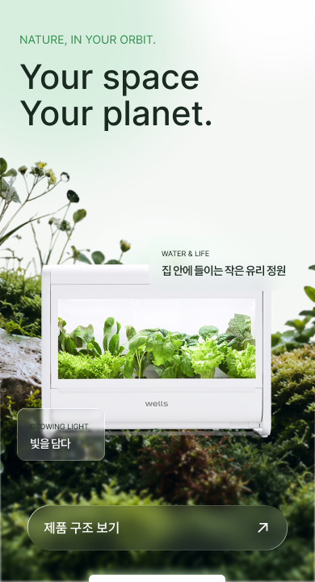

## 03. AI 팜이 안내

390 × 140px

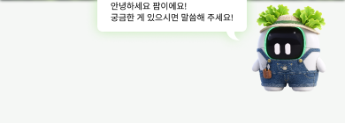

## 04. 제품 선택

390 × 630px

## 05. 제품 내부 구조

390 × 600px

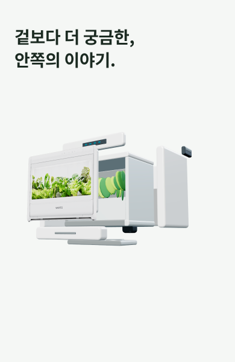

## 06. 사용 단계

390 × 582px

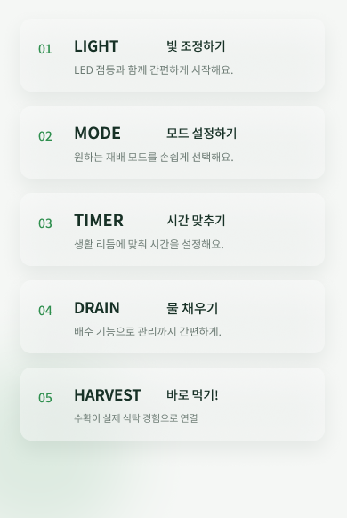

## 07. 재배 시스템

390 × 478px

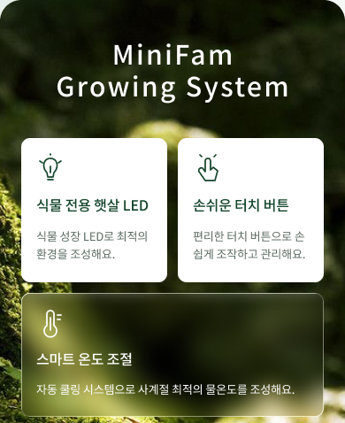

## 08. 공기 공급 · 배지 · 도어

390 × 335px

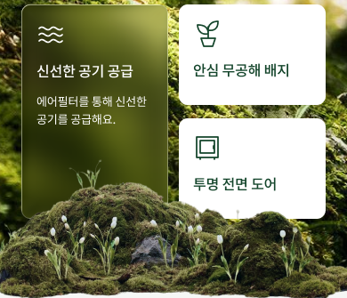

## 09. 조작방법

390 × 275px

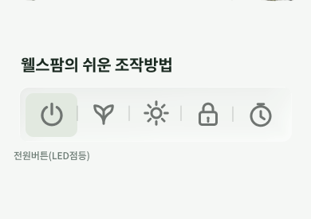

## 10. 채소 선택

390 × 600px

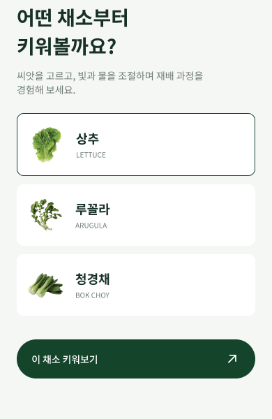

## 11. 일상 소개

390 × 225px

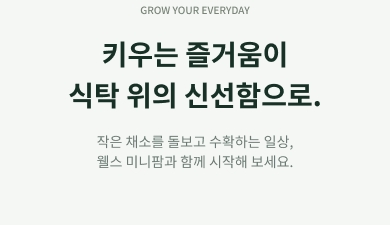

## 12. 공지사항 · 고객센터

390 × 490px

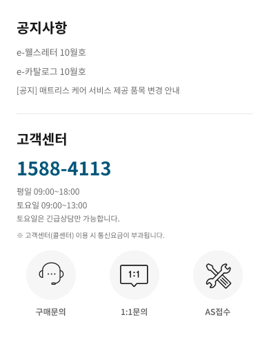

## 13. 푸터

390 × 300px

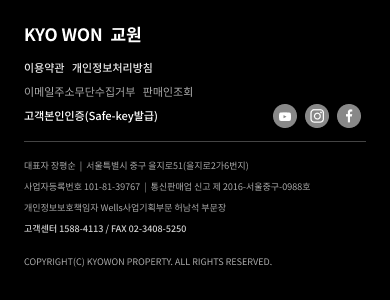

