# 섹션별 모바일 미리보기

각 섹션을 실제 HTML 화면에서 가로 390px, 2배 해상도로 따로 캡처했습니다. 아래 이미지는 390px 폭으로 표시됩니다. 제목·설명·버튼은 모두 실제 텍스트이며, 사진 부분만 이미지입니다.

## 01. 헤더

## 02. 메인 비주얼

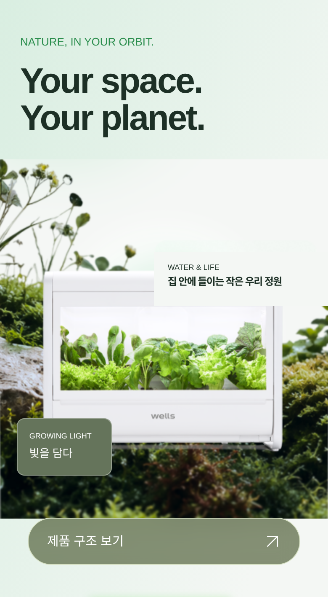

## 03. AI 팜이 안내

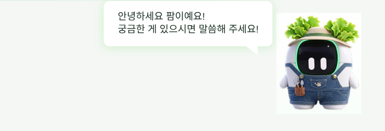

## 04. 제품 선택

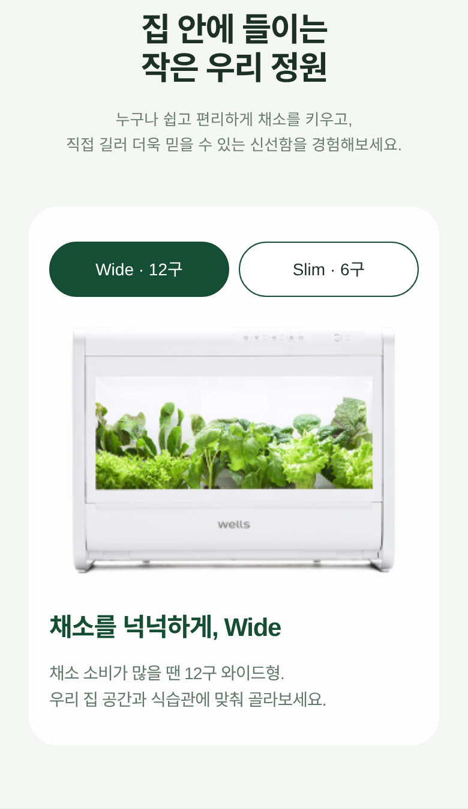

## 05. 제품 내부 구조

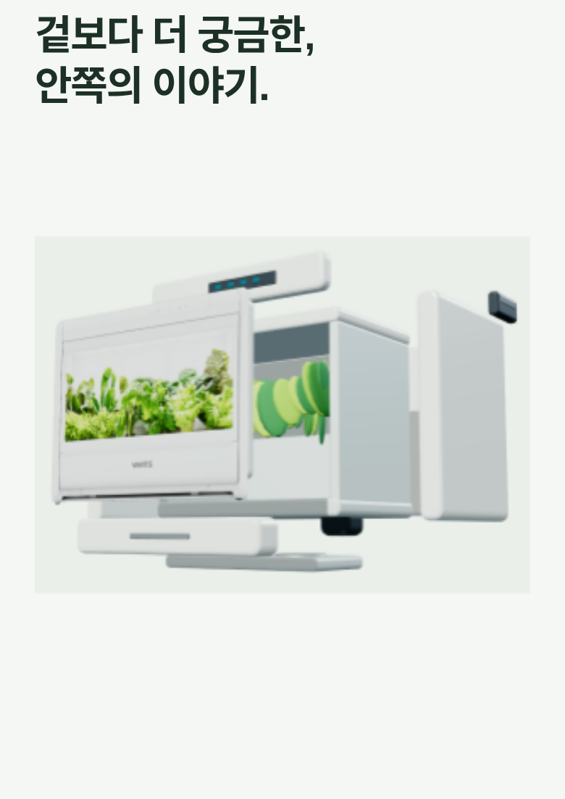

## 06. 사용 단계

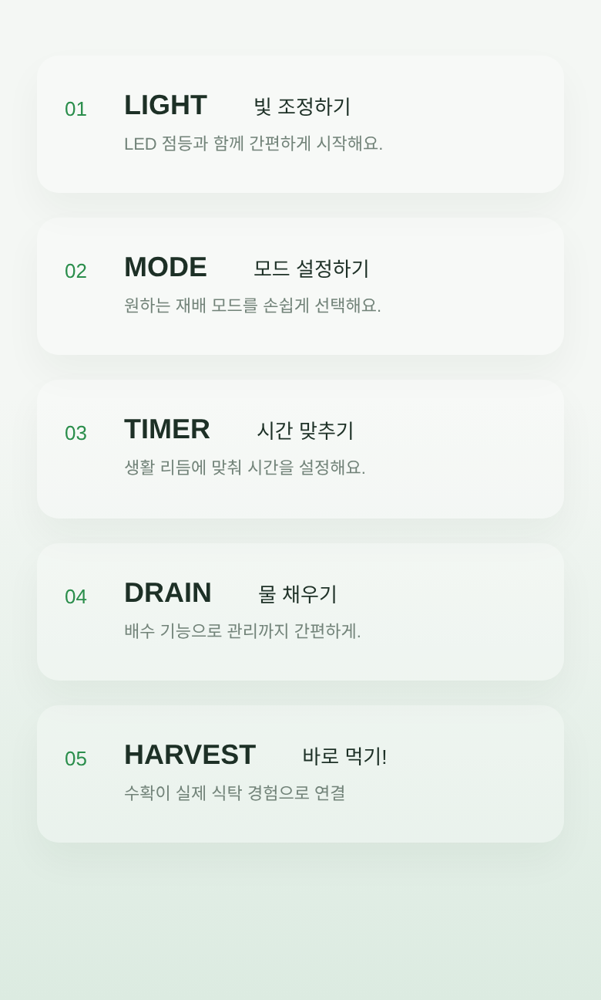

## 07. 재배 시스템

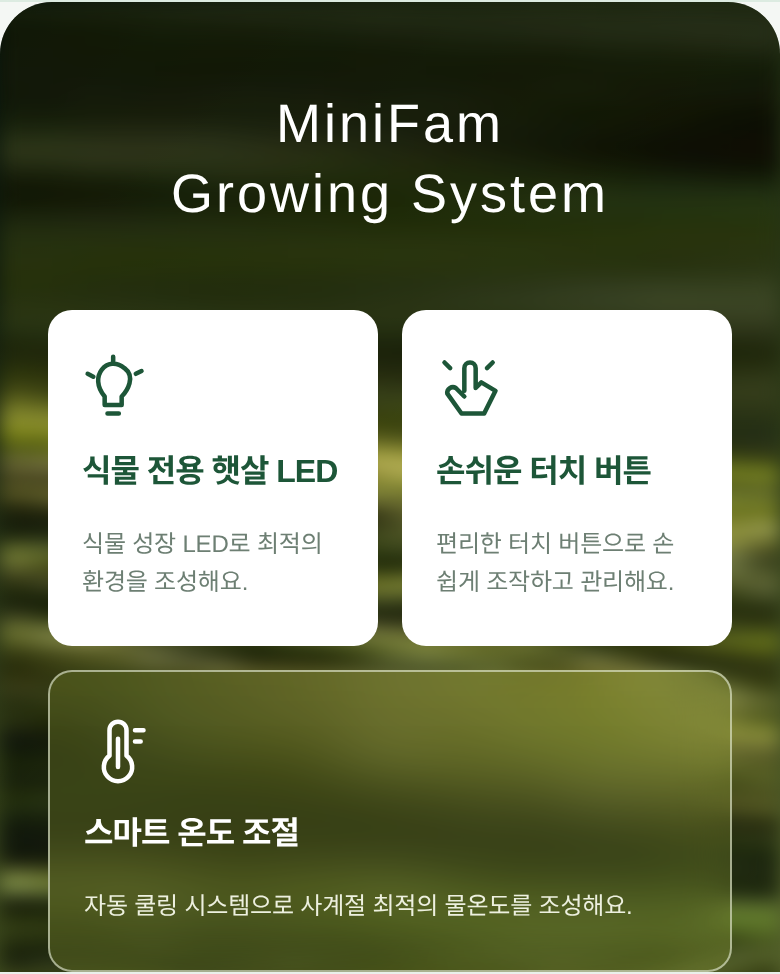

## 08. 공기 공급 · 배지 · 도어

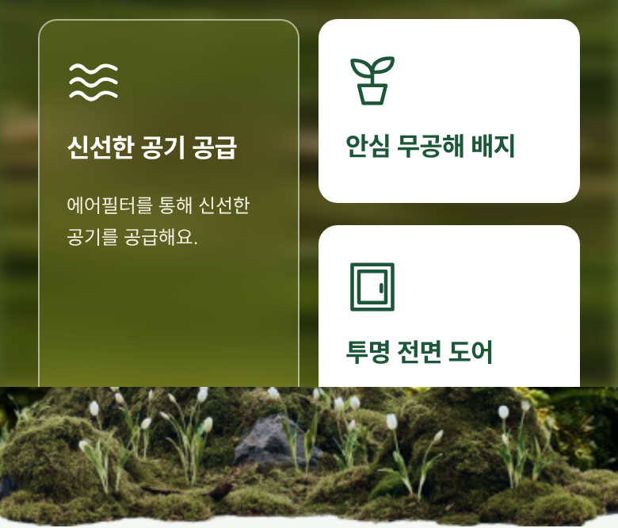

## 09. 조작방법

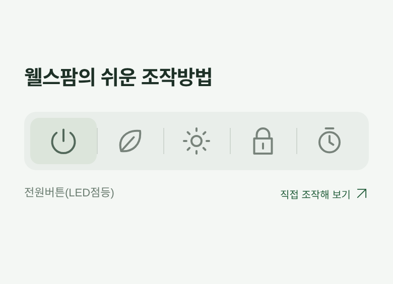

## 10. 채소 선택

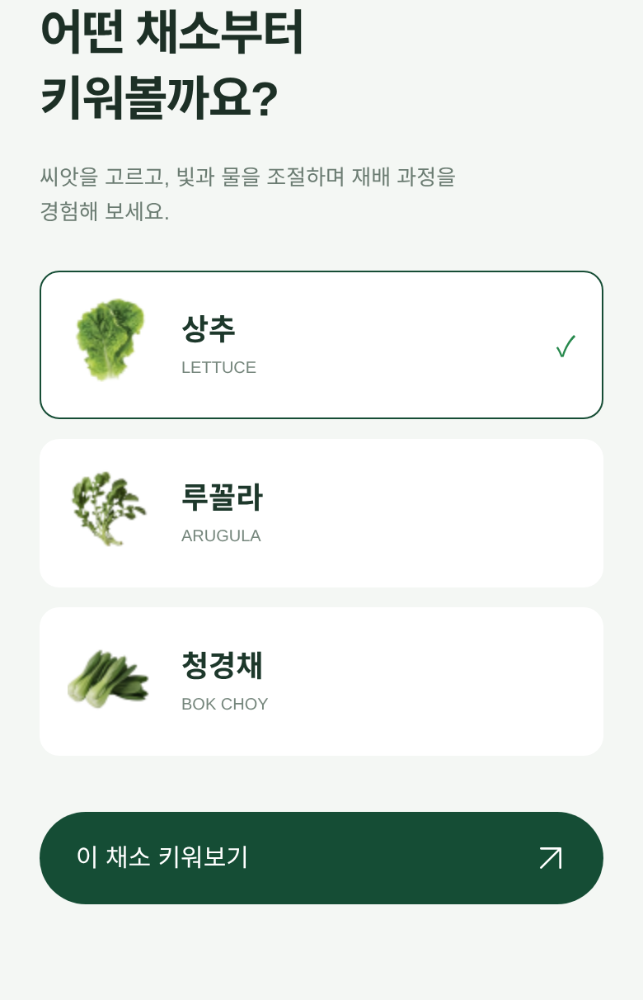

## 11. 일상 소개

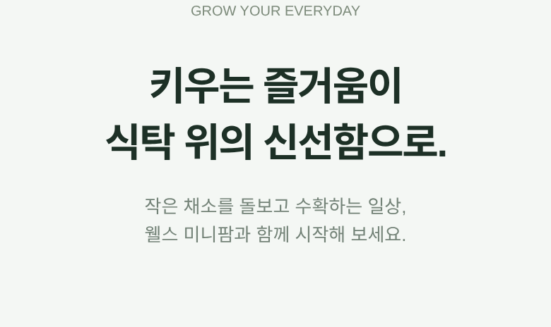

## 12. 공지사항 · 고객센터

## 13. 푸터

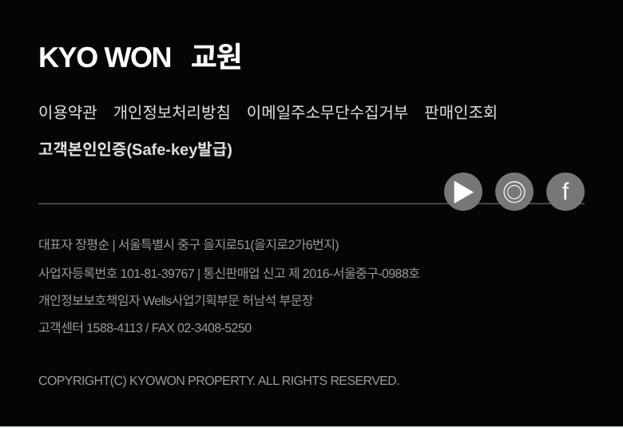

## 스마트 온도 조절 — 하단 팝업

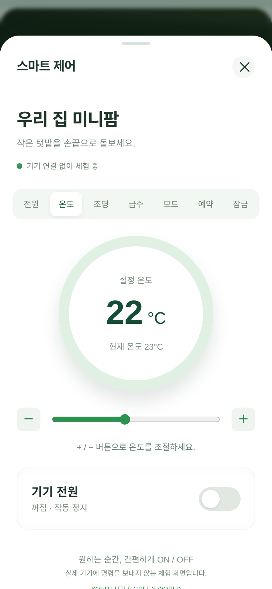
